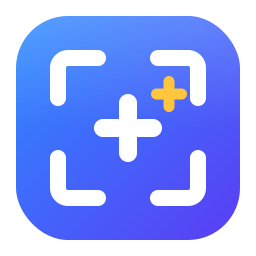

<p align="center"></p>

# ScreenShotPP

**A fast, native screenshot tool for macOS and Windows.**

Capture. Annotate. OCR. Copy. Done.

[Download for macOS](https://github.com/xVc323/ScreenShotPP/releases/latest) ·
[Download for Windows](https://github.com/xVc323/ScreenShotPP/releases/latest)


## Why ScreenShotPP?

ScreenShotPP is a lightweight open-source screenshot utility built for a fast daily
workflow. Its interface is fully native Rust ([egui](https://github.com/emilk/egui)),
with no embedded web view. Trigger a global shortcut, select a region, annotate it, extract text with
native OCR when needed, then copy or save the result.

## Features

- Fast region capture on the monitor under your cursor
- Floating annotation toolbar
- Rectangles, ellipses, lines, arrows, freehand drawing and text
- Numbered bubbles for tutorials and documentation
- Mosaic tool for hiding sensitive information
- Native OCR on macOS and Windows
- Copy to clipboard or save to disk
- PNG and JPEG output with optional size targets
- Configurable global shortcut and persistent settings
- Menu bar / system tray background app

## Keyboard shortcut

The default capture shortcut is:

| Platform | Shortcut |
|---|---|
| macOS | `⌘ ⇧ 2` |
| Windows | `Ctrl ⇧ 2` |

You can change it from the ScreenShotPP settings window.

## Installation

### macOS

1. Download the latest `.dmg` from [GitHub Releases](https://github.com/xVc323/ScreenShotPP/releases/latest).
2. Open the DMG and drag ScreenShotPP into `Applications`.
3. Launch ScreenShotPP and grant Screen Recording permission when macOS asks.

### Windows preview

1. Download the latest NSIS `.exe` installer from [GitHub Releases](https://github.com/xVc323/ScreenShotPP/releases/latest).
2. Run the installer.
3. If Microsoft SmartScreen warns about the unsigned preview build, verify that the
   installer comes from this repository, then choose **More info** → **Run anyway**.

The Windows installer will be signed in a future release. The project will apply to
[SignPath Foundation](https://signpath.org/) after the first public release.

## Roadmap

- Mac App Store release
- Microsoft Store release
- Signed Windows GitHub installer

The GitHub version remains free and includes the complete feature set.

## Development

### Prerequisites

- [Rust](https://www.rust-lang.org/tools/install) stable
- macOS: Xcode command line tools (the OCR/window bridge is compiled from Swift)
- Windows: Microsoft C++ Build Tools (MSVC + Windows SDK)
- For recording: an `ffmpeg` binary next to the built executable
  (`scripts/fetch-ffmpeg.sh <windows|macos-arm>` downloads one into `app/binaries/`)

### Run the checks

```bash
cargo test --manifest-path app/Cargo.toml --workspace
```

### Run / build locally

```bash
cargo run --manifest-path app/Cargo.toml
cargo build --release --manifest-path app/Cargo.toml
```

Installers (DMG, NSIS) are produced by [cargo-packager](https://github.com/crabnebula-dev/cargo-packager)
in GitHub Actions; public macOS releases are signed and notarized there with a
Developer ID Application certificate.

## Contributing

Issues and pull requests are welcome. Please run the Rust checks before submitting a change.

## ffmpeg

Video recording and GIF export use a bundled [FFmpeg](https://ffmpeg.org)
binary (GPL build), running as a separate process. FFmpeg is a trademark of
Fabrice Bellard. Windows builds from [BtbN/FFmpeg-Builds](https://github.com/BtbN/FFmpeg-Builds),
macOS builds from [martin-riedl.de](https://ffmpeg.martin-riedl.de).

## License

[MIT](LICENSE)
